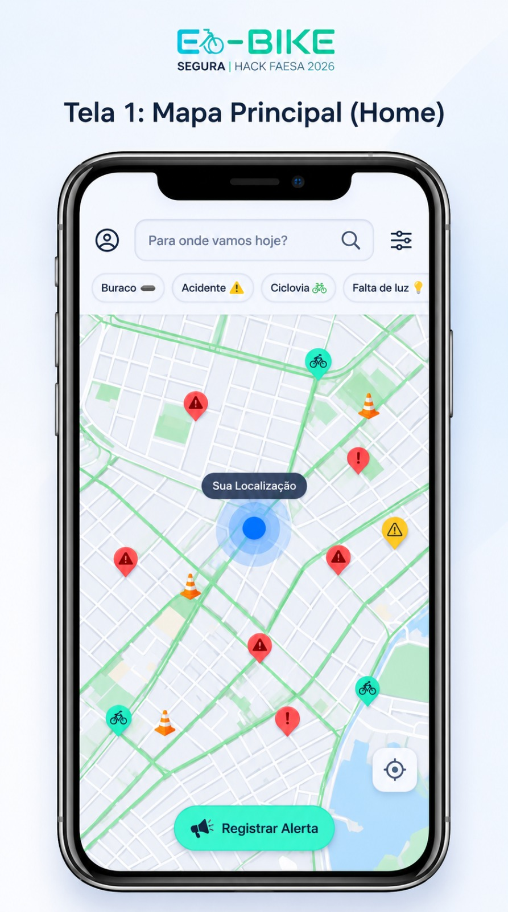
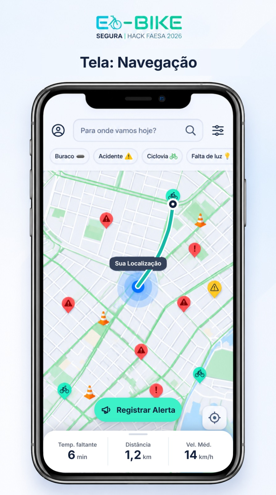
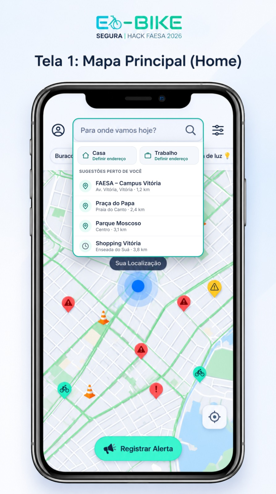
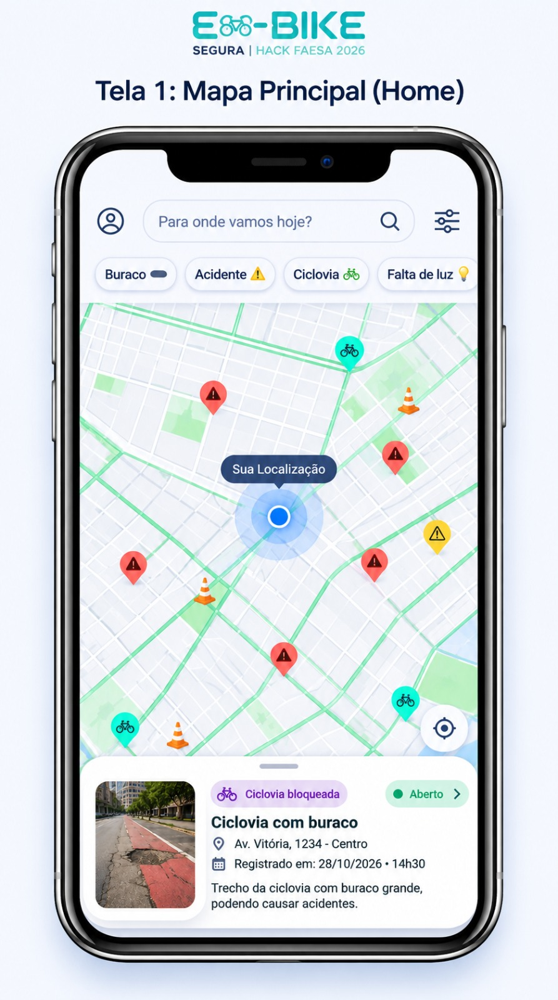
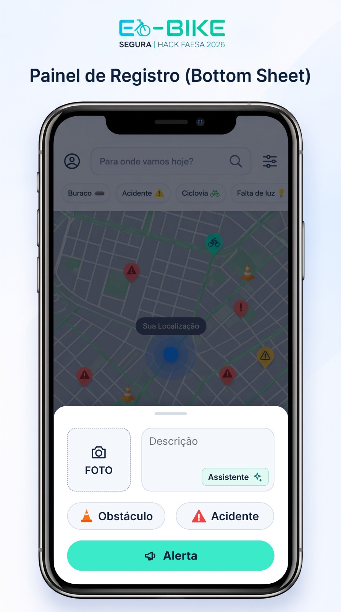
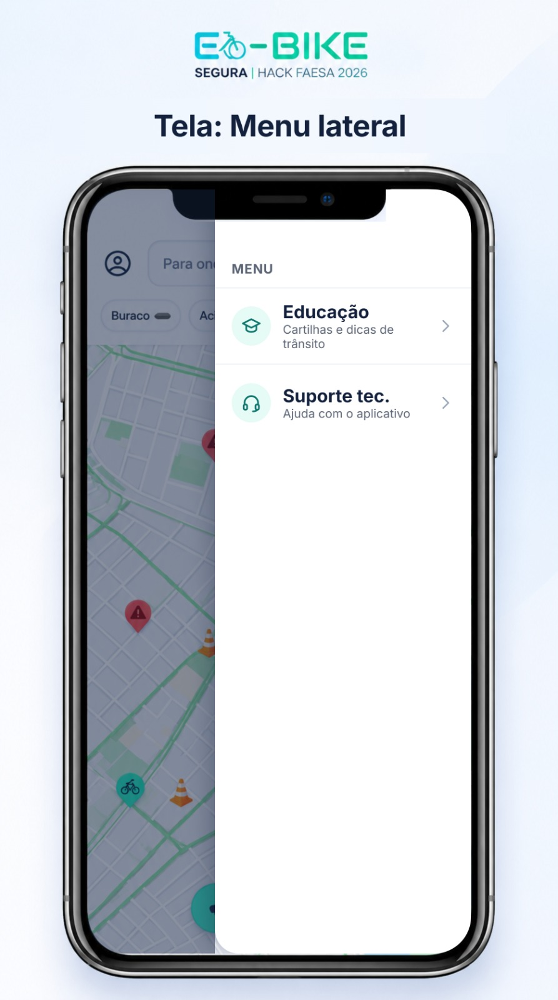
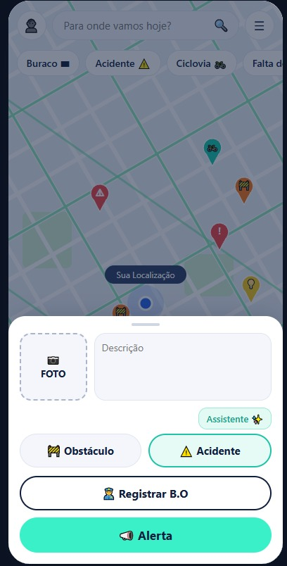

# 🚲 BikESafe — E-Bike Segura

> Aplicativo de mobilidade para ciclistas que mostra **rotas mais seguras** com base em alertas colaborativos: buracos, acidentes, trechos sem iluminação e ciclovias.
> Projeto desenvolvido para o **Hack FAESA 2026**, com foco em Vitória - ES.

<p align="center">
  
  
  
</p>

---

## 📌 O problema

Quem pedala na cidade não tem como saber, antes de sair, onde estão os buracos, os pontos de acidente ou as ruas escuras. Apps de navegação tradicionais otimizam só o **tempo**, não a **segurança** do ciclista.

## 💡 A solução

O BikESafe junta um mapa colaborativo de alertas com um roteador de bicicleta. Cada rota calculada recebe uma **pontuação de risco**, e o ciclista escolhe entre a opção *mais segura*, *mais rápida* ou *com menos subidas*. Durante o trajeto, o app acompanha o progresso, recalcula a rota se o ciclista sair dela e pergunta se os problemas registrados ainda existem.

---

## ✨ Funcionalidades

| | Funcionalidade | Descrição |
|---|---|---|
| 🗺️ | **Mapa de alertas** | Marcadores de buraco, acidente, ciclovia e falta de luz, com filtros por tipo no cabeçalho. |
| 🔥 | **Mapa de calor das ruas** | Trechos próximos a alertas ficam em tons de vermelho conforme o risco. |
| 🔍 | **Busca de destinos** | Autocomplete de endereços, atalhos para *Casa* e *Trabalho* e sugestões próximas. |
| 🛡️ | **Rotas por perfil** | *Mais segura*, *Mais rápida* e *Menos subidas*, cada uma com tempo, distância e quantidade de alertas no caminho. |
| 🧭 | **Navegação** | Tempo restante, distância e velocidade média, recálculo automático fora da rota e som de chegada. |
| 📣 | **Registrar alerta** | Foto, descrição (com sugestão do *Assistente*) e tipo do alerta: obstáculo ou acidente. |
| 🕵️ | **Ocorrência anônima** | Relato de infração, condução perigosa ou bicicleta mal estacionada. |
| ✅ | **Confirmação de incidentes** | Ao passar por um buraco ou acidente, o app pergunta se ele ainda está lá. |
| 👤 | **Perfil** | Dados do ciclista e avaliação. |
| 🧪 | **Simulação de trajeto** | Percorre a rota com velocidade de 1x, 3x ou 10x, útil para demonstrações. |

---

## 📱 Telas (protótipo)

<table>
  <tr>
    <td align="center"><br/><b>Mapa principal</b><br/><sub>Alertas, filtros e localização</sub></td>
    <td align="center"><br/><b>Busca</b><br/><sub>Casa, trabalho e sugestões</sub></td>
    <td align="center"><br/><b>Opções de rota</b><br/><sub>Segura, rápida ou plana</sub></td>
  </tr>
  <tr>
    <td align="center"><br/><b>Navegação</b><br/><sub>Tempo, distância e velocidade</sub></td>
    <td align="center"><br/><b>Detalhe do alerta</b><br/><sub>Foto, endereço e status</sub></td>
    <td align="center"><br/><b>Registrar alerta</b><br/><sub>Foto, descrição e tipo</sub></td>
  </tr>
  <tr>
    <td align="center"><br/><b>Menu lateral</b><br/><sub>Educação e suporte</sub></td>
    <td align="center"><br/><b>Perfil</b><br/><sub>Dados e avaliação</sub></td>
    <td align="center"><br/><b>App em execução</b><br/><sub>Painel de registro com B.O.</sub></td>
  </tr>
</table>

---

## 🧠 Como a rota "mais segura" é escolhida

O roteador (OSRM) não aceita "evite estes pontos", então o BikESafe calcula as rotas alternativas normalmente e **pontua cada uma** pelos alertas que ficam perto dela (`src/services/route-safety.ts`):

| Alerta | Peso no risco | Raio considerado |
|---|---|---|
| Falta de luz | `+1.5` | 30 m |
| Acidente | `+1.0` (meia-vida de 12 h) | 30 m |
| Buraco | `+0.1` | 30 m |
| Ciclovia | `−1.0` (deixa a rota mais segura) | 50 m |

- A rota de **menor risco** vira *Mais segura*. A de **menor duração** vira *Mais rápida*. Se as duas forem a mesma, ela aparece como *Mais rápida e segura*.
- O **gradiente de calor** da rota (`route-heat.ts`) amostra a linha a cada ~20 m e soma a influência de cada alerta com um núcleo gaussiano (σ = 45 m).
- Na **navegação** (`use-navigation.ts`), o app recalcula a rota quando o ciclista se afasta mais de 50 m dela e considera a chegada a menos de 30 m do destino.

---

## 🛠️ Tecnologias

- **[Expo SDK 58](https://docs.expo.dev/)** + **React Native 0.88** + **React 19** + **TypeScript**
- **[Expo Router](https://docs.expo.dev/router/introduction/)**: navegação baseada em arquivos (`src/app/`)
- **[MapLibre React Native](https://github.com/maplibre/maplibre-react-native)**: mapa vetorial
- **[Zustand](https://github.com/pmndrs/zustand)**: estado global (alertas, ocorrências, navegação, lugares)
- `expo-location`, `expo-image-picker`, `expo-audio`, `react-native-reanimated`

### Serviços abertos (sem chave de API)

| Serviço | Uso |
|---|---|
| [OpenFreeMap](https://openfreemap.org/) | Estilo e tiles do mapa |
| [OSRM / FOSSGIS](https://routing.openstreetmap.de/) | Rotas de bicicleta |
| [Photon (Komoot)](https://photon.komoot.io/) | Busca de endereços (autocomplete) |
| [Overpass / OpenStreetMap](https://overpass-api.de/) | Malha de ruas de Vitória para o mapa de calor |

> Dados © colaboradores do OpenStreetMap (ODbL).

---

## 🚀 Como rodar

### Pré-requisitos

- Node.js LTS e Yarn
- Android Studio com SDK e um emulador (ou um aparelho com depuração USB)

> ⚠️ O app usa **MapLibre**, um módulo nativo que **não roda no Expo Go**. É preciso um *development build*. Na web, o mapa não aparece (há um fallback só para o bundle não quebrar).

### Passo a passo

```bash
# 1. Instalar as dependências
yarn install

# 2. Compilar e abrir no Android (emulador ou aparelho)
npx expo run:android

# Nas próximas vezes, basta subir o Metro
npx expo start
```

No iOS (requer macOS): `npx expo run:ios`.

### Scripts úteis

| Comando | O que faz |
|---|---|
| `npx expo start` | Sobe o servidor de desenvolvimento |
| `npx expo run:android` | Gera e instala o build nativo no Android |
| `npx expo lint` | Lint do projeto |
| `npx tsc --noEmit` | Checagem de tipos |
| `node scripts/fetch-streets.mjs` | Baixa a malha de ruas de Vitória e gera `src/data/vitoria-streets.json` |

### Dicas para Windows

- **Caminhos longos:** o build Android pode falhar por causa do limite de 260 caracteres. Execute `habilitar-caminhos-longos.reg` (como administrador) e reinicie.
- **Erro `EBUSY` ao instalar pacotes:** o daemon do Gradle pode travar arquivos em `node_modules`. Rode `android\gradlew.bat --stop` antes de `yarn add`/`yarn install`.
- **`rodar-android.bat`:** limpa caches, abre o emulador `Medium_Phone` e roda o build.

---

## 📂 Estrutura do projeto

```
src/
├── app/                 # Telas (Expo Router)
│   ├── index.tsx        # Mapa principal
│   ├── route.tsx        # Planejamento e opções de rota
│   └── profile.tsx      # Perfil do ciclista
├── components/
│   ├── map/             # Mapa, marcadores, painéis de alerta e ocorrência
│   ├── route/           # Planejador de rota e marcador de destino
│   ├── navigation/      # Painel de navegação (tempo, distância, velocidade)
│   └── home/            # Cabeçalho de busca e marcador do usuário
├── services/            # Rotas (OSRM), geocodificação, segurança, mapa de calor, sons
├── hooks/               # Localização, navegação, busca, simulação, checagem de incidentes
├── store/               # Estado global com Zustand
├── data/                # Alertas de exemplo e malha de ruas de Vitória
└── constants/           # Tipos de alerta, cores da marca, tema e mapa
prototipo/               # Mockups das telas
scripts/                 # Scripts auxiliares (download da malha de ruas)
```

---

## 🗺️ Próximos passos

- [ ] Backend para persistir alertas e compartilhá-los entre usuários (hoje ficam só em memória)
- [ ] Autenticação e edição de perfil
- [ ] Dados de relevo reais para a rota *Menos subidas*
- [ ] Assistente com IA para descrever alertas a partir da foto
- [ ] Menu lateral com conteúdo de **Educação** (cartilhas de trânsito) e **Suporte técnico**
- [ ] Moderação e validação colaborativa dos alertas

---

## 📄 Licença

Distribuído sob a licença MIT. Veja [`LICENSE`](LICENSE).

<p align="center"><sub>Feito com 💚 para o Hack FAESA 2026</sub></p>
