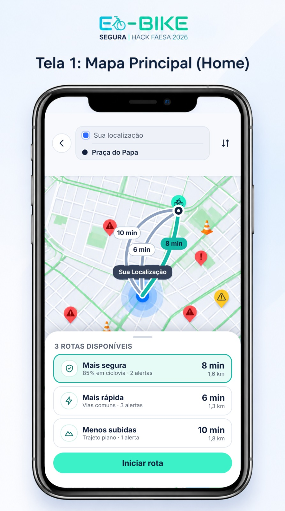

# 🚲 BikESafe — E-Bike Segura

> A mobility app for cyclists that shows **safer routes** based on crowdsourced alerts: potholes, accidents, unlit stretches and bike lanes.
> Built for **Hack FAESA 2026**, focused on Vitória, Brazil.

<p align="center">
  
  
  
</p>

---

## 📌 The problem

Cyclists have no way of knowing, before they set out, where the potholes, accident spots or dark streets are. Traditional navigation apps optimize only for **time**, not for the cyclist's **safety**.

## 💡 The solution

BikESafe combines a crowdsourced alert map with a bike router. Every calculated route gets a **risk score**, and the cyclist chooses between the *safest*, the *fastest* or the one *with the fewest hills*. During the ride, the app tracks progress, recalculates the route if the cyclist leaves it, and asks whether reported problems are still there.

---

## ✨ Features

| | Feature | Description |
|---|---|---|
| 🗺️ | **Alert map** | Markers for potholes, accidents, bike lanes and missing street lighting, with type filters in the header. |
| 🔥 | **Street heat map** | Stretches near alerts turn shades of red according to their risk. |
| 🔍 | **Destination search** | Address autocomplete, *Home* and *Work* shortcuts, and nearby suggestions. |
| 🛡️ | **Route profiles** | *Safest*, *Fastest* and *Fewest hills*, each with time, distance and the number of alerts along the way. |
| 🧭 | **Navigation** | Time left, distance and average speed, automatic rerouting when off route, and an arrival sound. |
| 📣 | **Report an alert** | Photo, description (with a suggestion from the *Assistant*) and alert type: obstacle or accident. |
| 🕵️ | **Anonymous incident report** | Report traffic violations, dangerous driving or badly parked bikes. |
| ✅ | **Incident confirmation** | When you pass a pothole or accident, the app asks whether it is still there. |
| 👤 | **Profile** | Cyclist details and rating. |
| 🧪 | **Ride simulation** | Rides the route at 1x, 3x or 10x speed, handy for demos. |
| 🌐 | **Bilingual** | Portuguese or English, following the device language (or the per-app language on Android 13+). |

---

## 📱 Screens (prototype)

The mockups are in Portuguese, the app's original language.

<table>
  <tr>
    <td align="center"><br/><b>Main map</b><br/><sub>Alerts, filters and location</sub></td>
    <td align="center"><br/><b>Search</b><br/><sub>Home, work and suggestions</sub></td>
    <td align="center"><br/><b>Route options</b><br/><sub>Safe, fast or flat</sub></td>
  </tr>
  <tr>
    <td align="center"><br/><b>Navigation</b><br/><sub>Time, distance and speed</sub></td>
    <td align="center"><br/><b>Alert details</b><br/><sub>Photo, address and status</sub></td>
    <td align="center"><br/><b>Report an alert</b><br/><sub>Photo, description and type</sub></td>
  </tr>
  <tr>
    <td align="center"><br/><b>Side menu</b><br/><sub>Education and support</sub></td>
    <td align="center"><br/><b>Profile</b><br/><sub>Details and rating</sub></td>
    <td align="center"><br/><b>Running app</b><br/><sub>Report panel with police report</sub></td>
  </tr>
</table>

---

## 🧠 How the "safest" route is chosen

The router (OSRM) can't be told to "avoid these points", so BikESafe calculates the alternative routes normally and then **scores each one** by the alerts near it (`src/services/route-safety.ts`):

| Alert | Risk weight | Radius |
|---|---|---|
| No lighting | `+1.5` | 30 m |
| Accident | `+1.0` (12 h half-life) | 30 m |
| Pothole | `+0.1` | 30 m |
| Bike lane | `−1.0` (makes the route safer) | 50 m |

- The route with the **lowest risk** becomes *Safest*. The one with the **shortest duration** becomes *Fastest*. If they are the same route, it shows as *Fastest and safest*.
- The route's **heat gradient** (`route-heat.ts`) samples the line every ~20 m and adds up the influence of each alert using a Gaussian kernel (σ = 45 m).
- During **navigation** (`use-navigation.ts`), the app recalculates the route when the cyclist strays more than 50 m from it, and counts as arrived within 30 m of the destination.

---

## 🛠️ Tech stack

- **[Expo SDK 58](https://docs.expo.dev/)** + **React Native 0.88** + **React 19** + **TypeScript**
- **[Expo Router](https://docs.expo.dev/router/introduction/)**: file-based navigation (`src/app/`)
- **[MapLibre React Native](https://github.com/maplibre/maplibre-react-native)**: vector map
- **[Zustand](https://github.com/pmndrs/zustand)**: global state (alerts, incidents, navigation, places)
- **[expo-localization](https://docs.expo.dev/versions/latest/sdk/localization/)**: device language (strings in `src/i18n/`)
- `expo-location`, `expo-image-picker`, `expo-audio`, `react-native-reanimated`

### Translations

Strings live in `src/i18n/pt.ts` (which defines the keys) and `src/i18n/en.ts` (type-checked to have the same keys). In components, use `t`:

```ts
import { t } from '@/i18n';

t.profile.title;              // "Perfil" / "Profile"
t.annotation.minutesAgo(5);   // "há 5 min" / "5 min ago"
```

Any language other than Portuguese falls back to English. The Portuguese iOS permission messages are in `languages/pt.json`.

### Open services (no API key)

| Service | Used for |
|---|---|
| [OpenFreeMap](https://openfreemap.org/) | Map style and tiles |
| [OSRM / FOSSGIS](https://routing.openstreetmap.de/) | Bike routing |
| [Photon (Komoot)](https://photon.komoot.io/) | Address search (autocomplete) |
| [Overpass / OpenStreetMap](https://overpass-api.de/) | Vitória street network for the heat map |

> Data © OpenStreetMap contributors (ODbL).

---

## 🚀 Getting started

### Prerequisites

- Node.js LTS and Yarn
- Android Studio with the SDK and an emulator (or a device with USB debugging)

> ⚠️ The app uses **MapLibre**, a native module that **does not run in Expo Go**. You need a *development build*. On the web the map is not shown (there is only a fallback so the bundle doesn't break).

### Step by step

```bash
# 1. Install dependencies
yarn install

# 2. Build and open on Android (emulator or device)
npx expo run:android

# After that, just start Metro
npx expo start
```

On iOS (requires macOS): `npx expo run:ios`.

> After changing native config in `app.json` (plugins, permissions, locales), regenerate the native project with `npx expo prebuild --clean` before building.

### Useful commands

| Command | What it does |
|---|---|
| `npx expo start` | Starts the dev server |
| `npx expo run:android` | Builds and installs the native app on Android |
| `npx expo lint` | Lints the project |
| `npx tsc --noEmit` | Type-checks |
| `node scripts/fetch-streets.mjs` | Downloads the Vitória street network and generates `src/data/vitoria-streets.json` |

### Windows tips

- **Long paths:** the Android build can fail because of the 260-character path limit. Run `habilitar-caminhos-longos.reg` (as administrator) and restart.
- **`EBUSY` error when installing packages:** the Gradle daemon can lock files in `node_modules`. Run `android\gradlew.bat --stop` before `yarn add`/`yarn install`.
- **`rodar-android.bat`:** clears caches, opens the `Medium_Phone` emulator and runs the build.

---

## 📂 Project structure

```
src/
├── app/                 # Screens (Expo Router)
│   ├── index.tsx        # Main map
│   ├── route.tsx        # Route planning and options
│   └── profile.tsx      # Cyclist profile
├── components/
│   ├── map/             # Map, markers, alert and incident panels
│   ├── route/           # Route planner and destination marker
│   ├── navigation/      # Navigation panel (time, distance, speed)
│   └── home/            # Search header and user marker
├── services/            # Routing (OSRM), geocoding, safety, heat map, sounds
├── hooks/               # Location, navigation, search, simulation, incident checks
├── i18n/                # Portuguese and English strings
├── store/               # Global state with Zustand
├── data/                # Sample alerts and Vitória street network
└── constants/           # Alert types, brand colors, theme and map
languages/               # Localized native strings (iOS permissions)
prototipo/               # Screen mockups
scripts/                 # Helper scripts (street network download)
```

---

## 🗺️ Next steps

- [ ] Backend to persist alerts and share them between users (today they live only in memory)
- [ ] Authentication and profile editing
- [ ] Real elevation data for the *Fewest hills* route
- [ ] AI assistant that describes alerts from the photo
- [ ] Side menu with **Education** content (traffic safety guides) and **Tech support**
- [ ] Moderation and crowdsourced validation of alerts

---

## 📄 License

Distributed under the MIT license. See [`LICENSE`](LICENSE).

<p align="center"><sub>Made with 💚 for Hack FAESA 2026</sub></p>
